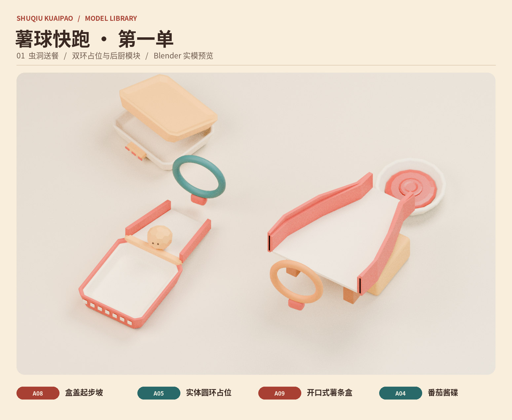

# 薯球快跑 | 后厨模型套件

单人混合现实解谜游戏《薯球快跑》的第一至第四关原型资产。按玩家的学习顺序制作，保持第一版的圆倒角、低面数、纯色快餐玩具风；不依赖斑点贴图、程序凹凸或外部贴图。

## 从这里开始

| 位置 | 用途 |
| --- | --- |
| [models/](models) | A01–A24 分件 FBX，给引擎导入和关卡搭建使用 |
| [source/Shuqiu_ModularKitchen.blend](source/Shuqiu_ModularKitchen.blend) | Blender 可编辑模型库，可按 A 编号追加集合 |
| [source/Level01_Bullet_Trace.blend](source/Level01_Bullet_Trace.blend) | 第一关盒盖和三条接球轨迹回放，打开后按空格播放，正常速度的 1/5 |
| [previews/](previews) | 第一关样机摆台、薯球四状态、按关卡分组的模型图鉴 |
| [docs/IMPORT.md](docs/IMPORT.md) | 单位、原点、分件、碰撞和装配索引 |
| [docs/manifest.json](docs/manifest.json) | 资产编号、实测网格三角面数、局部装配点与边界 |
| [docs/QA.md](docs/QA.md) | 可复现的第一关滚动测试与 Unity/PICO 待验项 |
| [build/](build) | Blender 生成源脚本；原始临时渲染可重建 |

**标准尺寸：** 球形碰撞直径 60 mm（原型暂定），1 Blender 单位 = 1 m。环的净内径、握持点与追踪对齐均为占位，收到实物尺寸后再定稿。外观、可动物件、代理碰撞与视觉层分件交付。进度条、传送与输入、挡片复位、油炸计时和反馈效果不作为模型自带功能。

**验证边界：** Blender 内置 Bullet 刚体检查和 FBX 回读可以在仓库重跑；Unity/PICO 的设备输入、碰撞接线、完整玩法和真机性能仍待实测。
